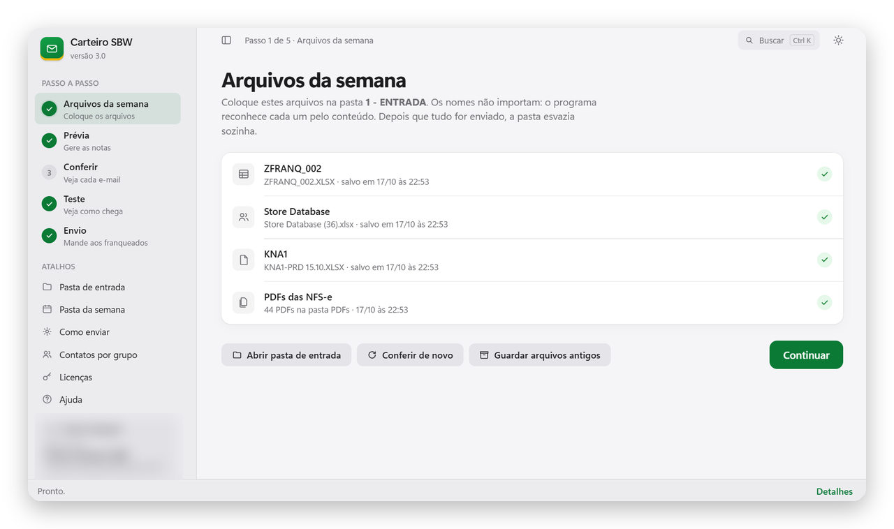
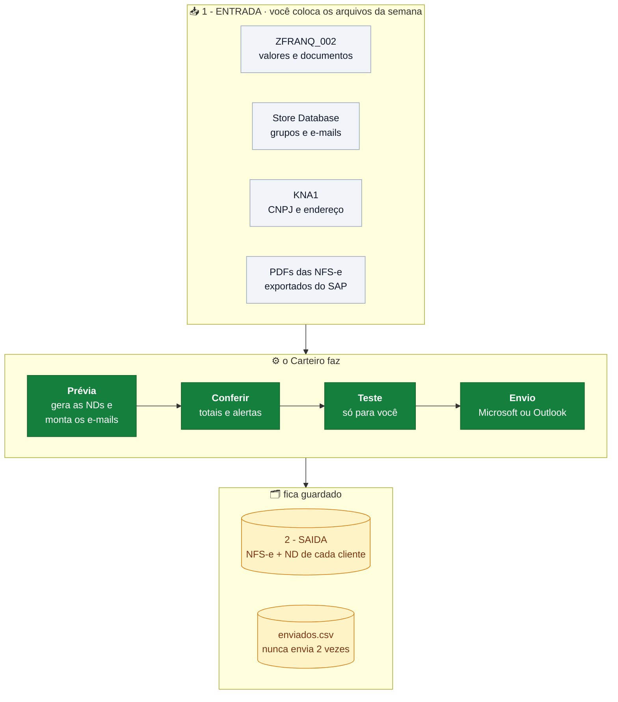
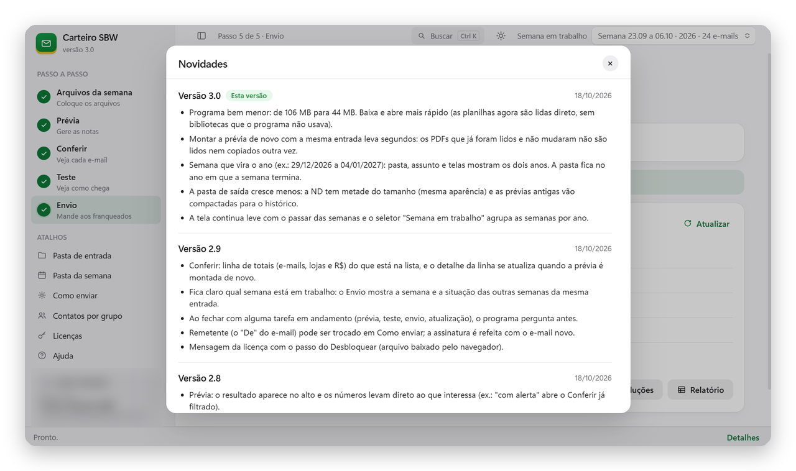

  

<h1 align="center">Carteiro SBW</h1>

  As NFS-e e a Nota de Débito da semana, num e-mail para cada franqueado Subway. 
  Programa interno do Contas a Receber da ZAMP.

  
  
  

## O que ele faz

- **Gera a Nota de Débito** de cada loja em PDF (o SAP não emite), com os valores da ZFRANQ_002.
- **Junta as NFS-e** que o SAP exporta e avisa se falta alguma.
- **Monta um e-mail por grupo de franqueado** (ou por loja), com a tabela dos documentos e o vencimento.
- **Envia** pela conta Microsoft ou pelo Outlook, com prévia, teste, pausa e controle para nunca mandar a mesma nota duas vezes.

## Instalar

1. Baixe o **CarteiroSBW.exe** pelo botão acima.
2. Clique com o botão direito no arquivo → **Propriedades** → marque **Desbloquear** → **OK**.
3. Abra. Se aparecer *"O Windows protegeu o computador"*, clique em **Mais informações → Executar assim mesmo**.
4. Na primeira vez, o programa pede a **licença** (enviada pelo responsável) e a **pasta do Carteiro** (ele procura sozinho no OneDrive).

Não precisa instalar Python nem mais nada. Depois, para atualizar, basta o botão **Atualizar** dentro do programa.

## Toda semana, em 5 passos

| | Passo | O que acontece |
|:-:|---|---|
| 1 | **Arquivos da semana** | Você coloca a ZFRANQ_002, a Store Database, a KNA1 e os PDFs das NFS-e na pasta de entrada. O programa reconhece cada arquivo pelo conteúdo. |
| 2 | **Prévia** | Gera as NDs, junta as NFS-e de cada loja, saneia os e-mails da Store Database e monta os e-mails. Nada é enviado. |
| 3 | **Conferir** | A lista de e-mails, com totais, alertas e o detalhe de cada um. |
| 4 | **Teste** | Alguns e-mails só para você, para ver como chegam. |
| 5 | **Envio** | Envia aos franqueados, com pausa, retomada e relatório no fim. |

<!-- NOVIDADES:INICIO -->
## Novidades da versão 3.3

18/10/2026

- A pasta compartilhada guarda só os dados: o código do programa saiu dela, e a tela vem sempre de dentro do CarteiroSBW.exe (ninguém muda a tela de todos sem querer).
<!-- NOVIDADES:FIM -->

O histórico completo está em [Releases](https://github.com/HenioSampaio/carteiro-sbw-versoes/releases) e na tela **Novidades** do programa.

## Perguntas frequentes

<b>Apaguei o programa e baixei de novo. Perco a licença?</b>

 
Não. A licença fica no seu usuário do Windows, não no arquivo. Basta abrir o programa novo.

<b>O Windows ou o navegador bloqueou o arquivo.</b>

 
O programa não tem assinatura digital de empresa, então o Windows desconfia de arquivos baixados. Faça o passo do <b>Desbloquear</b> (Instalar, item 2). Quem atualiza pelo botão dentro do programa não vê esse aviso.

<b>Posso usar em outro computador?</b>

 
Sim. A licença vale para o seu usuário da empresa, em qualquer computador em que você entre com ele.

<b>Como o programa se atualiza?</b>

 
Ele consulta o <code>versao.json</code> deste repositório. Quando há versão nova, baixa o <code>CarteiroSBW.exe</code>, confere o SHA-256 e só então troca o arquivo e reabre.

## Segurança e privacidade

- Este repositório tem só o programa compilado e o `versao.json`. Nenhuma planilha, nota, e-mail de cliente ou senha.
- O programa só abre com licença emitida pelo responsável, assinada digitalmente (Ed25519) e ligada ao usuário do Windows. Licenças podem ser revogadas.
- A senha ou o login Microsoft ficam protegidos no seu usuário do Windows, nunca em arquivo.
- Cada versão é conferida pelo SHA-256 antes de ser instalada.

Uso interno · ZAMP III S.A. · código-fonte em repositório privado

